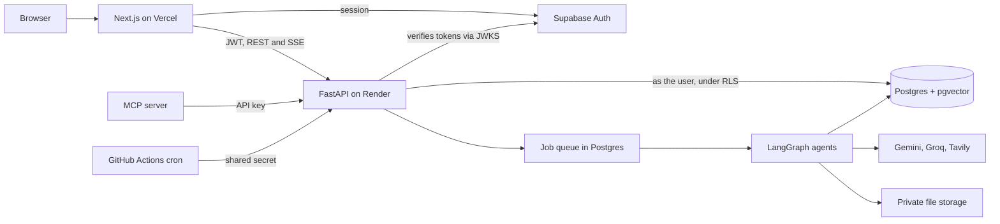
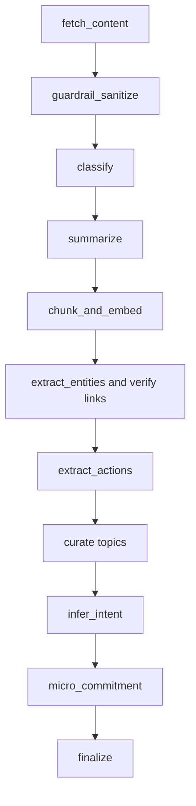

# Recall

*Your AI memory and action layer for everything you save.*

> Everyone saves hundreds of posts, videos and docs but almost never acts on them. Recall is a multi-agent AI system that turns saved content into context-aware micro-actions, surfaces the right save at the right moment, and tracks whether your saves actually change your behavior.

**Live site:** add your URL here after deploying ([steps](DEPLOYMENT.md)).

## The idea: the Save-to-Action Engine

Most tools make saving easier. Recall measures what saving leads to.

1. **Asks why.** A two-second prompt on save, or the agent infers your intent.
2. **Shrinks the task.** Your intent becomes the smallest concrete first step, with a suggested time.
3. **Shows up at the right moment.** An exam tomorrow or a client call at 3 brings back the saves that matter for it.
4. **Asks "Did you do it?"** Done, Not yet, or Let go. A task you keep postponing gets smaller, then Recall asks whether to keep it.
5. **Tells you the truth.** Your Save-to-Action score comes from an event log, and a weekly reflection points out your patterns, sometimes suggesting you save less.

## What's in it

- **Universal capture:** links, YouTube, articles, PDFs, images, audio, video and notes
- **Smart Cards:** summary, timestamped transcript, verified resources and an action plan that needs your approval
- **Ask Your Brain:** agentic RAG with streaming answers and citations, plus chat with any single save
- **Learn Mode:** flashcards and quizzes, scheduled with SM-2
- **Knowledge Graph:** your topics and how they connect, with obsessions and blind spots
- **Teams:** shared workspaces, roles, invites, action items with owners, and meeting briefings
- **Google Calendar** (optional, read and create on approval), with `.ics` export as a fallback
- **MCP server:** search your saves and tasks from any MCP client

## Architecture



## The ingestion graph



Steps after `chunk_and_embed` are optional: if a service is having a bad day, you keep your save and lose only that extra.

## Engineering decisions

- **The model can't invent links.** It chooses by index from real search results, so a URL it makes up has nowhere to go. A separate, purely mechanical check decides what counts as verified: the page must load, and the domain must match the brand by whole label, which stops lookalikes such as `notstripe-reviews.example`.
- **The database enforces tenancy, and API requests run as the user.** Every table has row-level security. Each request opens a transaction under the `authenticated` Postgres role with that user's claims, so a handler with a missing check still can't read another workspace.
- **Agentic RAG.** Vector and full-text search are fused with Reciprocal Rank Fusion. The agent grades what it finds, rewrites weak queries at most twice, and checks the answer for groundedness, warning you when it can't support something.
- **Saved content is untrusted.** Injection patterns are removed, content is wrapped as data, and nothing a page says can trigger a tool. Link fetching blocks private addresses at every redirect, to prevent SSRF.
- **Outside actions wait for you.** Calendar events and invites only happen on an explicit click.
- **Free-tier honest.** The job queue lives in Postgres and runs inside the API process, so no paid worker is needed. Jobs interrupted by a sleeping server are picked up again, and providers fall back from Gemini to Groq when throttled.

## Tech stack

| Layer | Choice |
|---|---|
| Frontend | Next.js (App Router), TypeScript, Tailwind CSS, shadcn/ui, TanStack Query, Motion, React Flow, Recharts |
| Backend | FastAPI, Pydantic v2, async SQLAlchemy, LangGraph |
| Database | Supabase Postgres, pgvector, row-level security |
| Auth | Supabase Auth (email and Google), with tokens verified in the API via JWKS |
| AI | Gemini, Groq (including Whisper), Tavily, all behind swappable interfaces |
| Testing | Vitest, pytest on embedded Postgres, PGlite migration tests, Playwright end to end |

## Evals

`make eval` measures classification, link accuracy, action extraction and RAG faithfulness on labeled data in [apps/api/evals](apps/api/evals/), using the real providers. Results are written to `apps/api/evals/results.md` only by that script, so if the file isn't there, the evals haven't been run yet.

## Run it locally

Needs Node 20.9+ and [uv](https://docs.astral.sh/uv/). Sign-in needs a free Supabase project, and AI features need free API keys: [DEPLOYMENT.md](DEPLOYMENT.md) covers both.

```bash
make setup
```

```bash
make dev-api
```

```bash
make dev-web
```

Run the checks, none of which need an account:

```bash
make check
```

```bash
make e2e
```

## MCP server

Create an API key under **Settings > API keys**, then add this to your MCP client's configuration, using your own path and key:

```json
{
  "mcpServers": {
    "recall": {
      "command": "uv",
      "args": ["run", "--directory", "/path/to/recall/apps/mcp", "recall-mcp"],
      "env": {
        "RECALL_API_KEY": "rk_your_key",
        "RECALL_API_URL": "https://your-api.onrender.com"
      }
    }
  }
}
```

Tools: `search_saves`, `get_save`, `list_tasks`, `create_save`.

## Repository layout

```
apps/web/             Next.js frontend, with Playwright tests in e2e/
apps/api/             FastAPI backend, agents, worker and evals
apps/mcp/             MCP server
supabase/migrations/  SQL schema and row-level security (source of truth)
supabase/seed/        Demo account data
supabase/local/       Stand-in for Supabase's auth schema, for local testing only
```

## Roadmap

Chrome extension, PWA share target, Telegram capture, emailed digests, and a semantic cache.

## License

[MIT](LICENSE)
